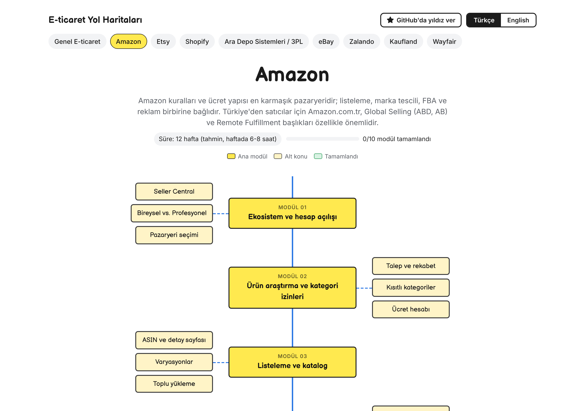
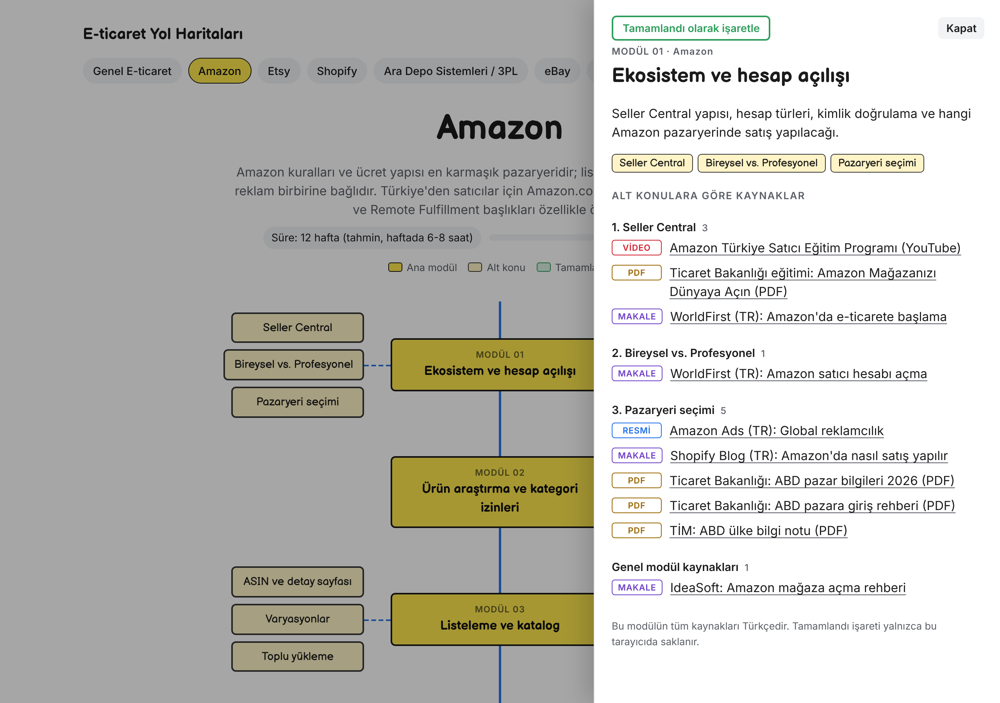
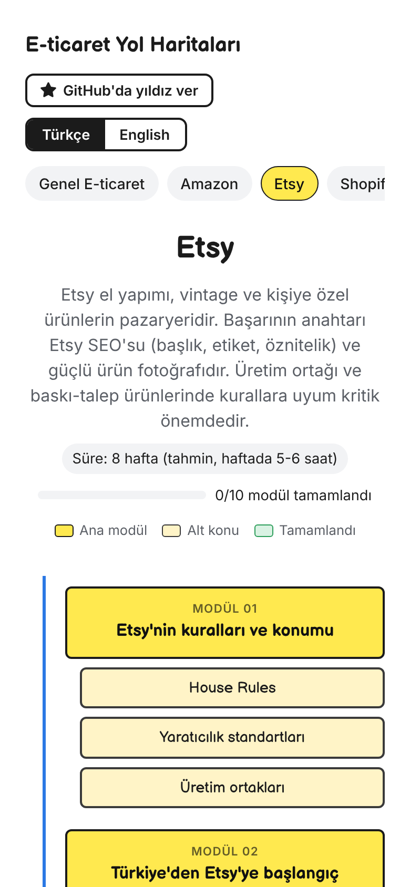
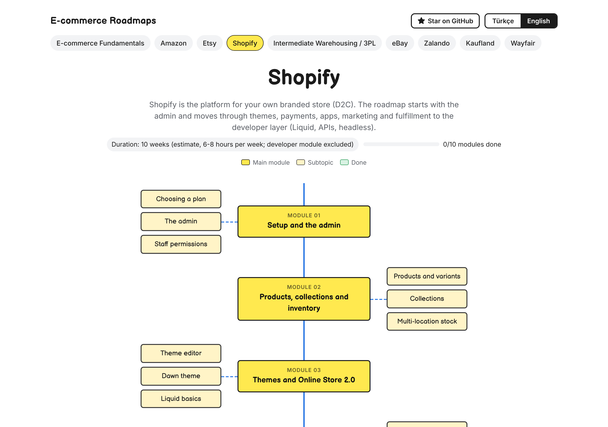

<div align="center">

# 🛒 E-ticaret Yol Haritaları

**Amazon, Etsy, Shopify, eBay, Zalando, Kaufland, Wayfair ve 3PL için roadmap.sh tarzı, interaktif ve ücretsiz öğrenme yol haritaları.**
Türkçe ve İngilizce. Her alt konu doğrulanmış kaynaklara bağlanır.

[](https://alexduncan2100.github.io/ecommerce-roadmap/)
[](https://github.com/AlexDuncan2100/ecommerce-roadmap/stargazers)
[](LICENSE)
[](CONTRIBUTING.md)

**[🚀 Siteyi aç](https://alexduncan2100.github.io/ecommerce-roadmap/)** · [English](#-english) · [Katkıda bulun](CONTRIBUTING.md)

<a href="https://alexduncan2100.github.io/ecommerce-roadmap/"></a>

</div>

## Ne var?

| | |
|---|---|
| 🗺️ **9 yol haritası** | Genel e-ticaret, Amazon, Etsy, Shopify, Ara depo / 3PL, eBay, Zalando, Kaufland, Wayfair |
| 📚 **90 modül, 270 alt konu** | Her yol haritası 10 modül; her modülde 3 alt konu |
| 🔗 **~800 kaynak linki** | Resmi dokümanlar, Ticaret Bakanlığı ve TİM rehberleri, YouTube kanalları, otorite blogları |
| 🇹🇷 / 🇬🇧 **İki dil** | Türkçe sürümde yalnızca Türkçe, İngilizce sürümde yalnızca İngilizce kaynaklar |
| ✅ **İlerleme takibi** | Modülleri "tamamlandı" olarak işaretle; ilerleme tarayıcında saklanır |
| 🧾 **Cheat sheet'ler** | Her platform için ücretler, kurallar ve kısa hatırlatma kartları |
| 📱 **Her cihazda** | Telefon, tablet, masaüstü; açık ve koyu tema |

## Nasıl kullanılır?

1. **[Siteyi aç](https://alexduncan2100.github.io/ecommerce-roadmap/)** ve üstteki sekmelerden bir platform seç.
2. Sarı **modül** kutusuna ya da yanındaki **alt konu** kutusuna tıkla. Sağda o konunun kaynakları açılır.
3. Linke tıkla, kaynağı oku ya da izle. Bitirince **"Tamamlandı olarak işaretle"** butonuna bas.

Doğrudan linkler: [Genel](https://alexduncan2100.github.io/ecommerce-roadmap/#genel) · [Amazon](https://alexduncan2100.github.io/ecommerce-roadmap/#amazon) · [Etsy](https://alexduncan2100.github.io/ecommerce-roadmap/#etsy) · [Shopify](https://alexduncan2100.github.io/ecommerce-roadmap/#shopify) · [3PL](https://alexduncan2100.github.io/ecommerce-roadmap/#3pl) · [eBay](https://alexduncan2100.github.io/ecommerce-roadmap/#ebay) · [Zalando](https://alexduncan2100.github.io/ecommerce-roadmap/#zalando) · [Kaufland](https://alexduncan2100.github.io/ecommerce-roadmap/#kaufland) · [Wayfair](https://alexduncan2100.github.io/ecommerce-roadmap/#wayfair)

<table>
<tr>
<td width="62%"><br><sub>Bir kutuya tıklayınca kaynaklar alt konulara göre açılır.</sub></td>
<td width="38%"><br><sub>Telefonda da aynı şekilde çalışır.</sub></td>
</tr>
</table>

## Yol haritaları

| Yol haritası | Kimin için | Süre (tahmin) |
|---|---|---|
| Genel E-ticaret | Sıfırdan başlayanlar | 10-12 hafta |
| Amazon | FBA / FBM, global satış | 12 hafta |
| Etsy | El yapımı, dijital ürün, POD | 8 hafta |
| Shopify | Kendi markalı mağaza (D2C) | 10 hafta |
| Ara Depo / 3PL | Depo, fulfillment, lojistik | 10 hafta |
| eBay | Global pazaryeri satıcıları | 8 hafta |
| Zalando | Moda markaları (Avrupa) | 6-8 hafta |
| Kaufland | Almanya ve Orta Avrupa | 6 hafta |
| Wayfair | Mobilya ve ev ürünleri tedarikçileri | 6 hafta |

Süreler haftada 4-8 saat çalışma varsayımıyla verilmiş tahminlerdir.

## Kaynak seçme kuralları

- Önce **resmi kaynak**: platformların kendi yardım merkezleri, seller university sayfaları, API dokümanları.
- Sonra **kamu ve otorite kaynakları**: T.C. Ticaret Bakanlığı e-ihracat eğitimleri, Pazar Bilgileri raporları, TİM ülke bilgi notları.
- Reklam amaçlı, içeriği zayıf ya da tekrar eden sayfalar eklenmez.
- Linkler 27 Kasım 2026'da kontrol edildi. Kırık bir link görürsen [bildir](https://github.com/AlexDuncan2100/ecommerce-roadmap/issues/new?template=kirik-link.yml).

## Katkıda bulun

Bildiğin değerli bir kaynak mı var? Bir link mi kırılmış? Katkılar çok değerli. 🙌

- 💡 [Kaynak öner](https://github.com/AlexDuncan2100/ecommerce-roadmap/issues/new?template=kaynak-oner.yml) (kod bilgisi gerekmez)
- 🐛 [Kırık link bildir](https://github.com/AlexDuncan2100/ecommerce-roadmap/issues/new?template=kirik-link.yml)
- 🛠️ Doğrudan PR göndermek için [katkı rehberine](CONTRIBUTING.md) bak.

Proje işine yaradıysa **⭐ yıldız vermeyi** unutma; daha çok kişinin bulmasına yardım eder.

## Yerelde çalıştırma

Site tek bir `index.html` dosyasıdır; kurulum gerekmez. Dosyayı tarayıcıda açman yeterli.

Veriyi değiştirdiysen siteyi yeniden üret (Node.js 18+):

```bash
npm run build
```

```
src/
  roadmaps.js   # 9 yol haritası, modüller, alt konular, modül kaynakları
  cheat.js      # cheat sheet kartları
  subres.js     # alt konu kaynakları
  add.tsv       # ek kaynaklar (her satır bir link)
  merge.js      # kaynakları birleştirir, tekrar edenleri ayıklar -> subdata.js
  template.html # arayüz
  build.js      # index.html'i üretir
```

---

## 🇬🇧 English

**Free, interactive, roadmap.sh-style learning roadmaps for e-commerce:** Amazon, Etsy, Shopify, eBay, Zalando, Kaufland, Wayfair and 3PL / fulfillment, plus an e-commerce fundamentals track.

- **9 roadmaps, 90 modules, 270 subtopics, ~800 curated links**
- Click any box to open the resources for that subtopic: official docs, YouTube channels, authority blogs
- The English version links only English sources; switch languages at the top right
- Track your progress (stored locally in your browser), cheat sheets, light and dark themes, mobile friendly

👉 **[Open the roadmaps](https://alexduncan2100.github.io/ecommerce-roadmap/)**



Contributions are welcome: [suggest a resource](https://github.com/AlexDuncan2100/ecommerce-roadmap/issues/new?template=kaynak-oner.yml), [report a broken link](https://github.com/AlexDuncan2100/ecommerce-roadmap/issues/new?template=kirik-link.yml) or read [CONTRIBUTING.md](CONTRIBUTING.md). If it helps you, please **⭐ star the repo**.

## Lisans

Kod [MIT](LICENSE) lisanslıdır. Linklenen içerikler kendi sahiplerine aittir.
